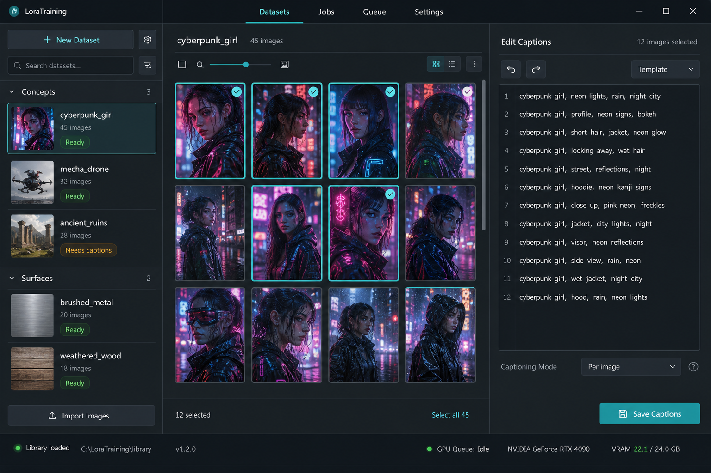

# LoraTraining

[](https://github.com/aipower66669/LoraTraining/releases/latest)
[](LICENSE)

**LoraTraining** is a Windows desktop UI for **Krea 2 text-to-image LoRA** workflows. It is built on top of [AI Toolkit](https://github.com/ostris/ai-toolkit) — **it does not perform training itself**. The app’s main job is **dataset management**: categories, image folders, captions, hygiene tools, job YAML, and a FIFO queue that **starts** AI Toolkit when you are ready.

> **Intended audience:** Experienced local-AI users with working installations of [AI Toolkit](https://github.com/ostris/ai-toolkit), [ComfyUI](https://github.com/comfyanonymous/ComfyUI), and optionally a CUDA Python env for the bundled JoyCaption script ([HF model](https://huggingface.co/fancyfeast/llama-joycaption-beta-one-hf-llava)). LoraTraining is an **orchestration and management** application — not an environment installer, not a turnkey training package, and not aimed at general consumers.
>
> It configures and orchestrates **existing** installs. It does **not** install, repair, or maintain AI Toolkit, ComfyUI, caption/training Python stacks, their models, CUDA, or third-party Comfy custom nodes. Upstream install and dependency troubleshooting are outside this project’s scope.

Captioning, training, and Comfy previews run as **external processes** you already have working. LoraTraining owns the library workspace on disk, orchestration, and live progress — not the diffusion weights or training loop.

**Models:** **Krea 2 only** — training defaults, Comfy starter workflows, and preview tools are built and tested for Krea 2. Other AI Toolkit architectures are not supported in this release.

| | |
| --- | --- |
| **Platform** | Windows 10 / 11 (primary) |
| **Stack** | Electron · React · TypeScript · Zustand · Zod |
| **License** | **GPL-3.0-only** — [LICENSING.md](LICENSING.md) · [TRADEMARK.md](TRADEMARK.md) |
| **Version** | **0.4.0** — [Release notes](RELEASE_NOTES.md) |



<!-- Optional product GIF (dataset → captions → queue → validation). Drop a ~20–30s
     looping capture at docs/image/workflow.gif and uncomment:

-->

---

## Download and install

1. Open **[GitHub Releases](https://github.com/aipower66669/LoraTraining/releases/latest)** and download `LoraTraining Setup X.Y.Z.exe`.
2. Optionally verify the SHA-256 against `SHA256SUMS.txt` on the same release (see [docs/BUILD.md](docs/BUILD.md#unsigned-installer--smartscreen)).
3. Run the installer. The build is **unsigned** — Windows SmartScreen may warn; use **More info → Run anyway** if you trust the release.
4. Launch **LoraTraining**, set a **library root**, then follow **[docs/SETUP.md](docs/SETUP.md)** to **point Settings at tools you already run successfully on their own** (AI Toolkit, JoyCaption, ComfyUI).

If CUDA, Python venvs, model downloads, or Comfy Manager packs are failing, fix those **upstream** first — LoraTraining will not diagnose or repair them.

User guide: **[docs/USER_GUIDE.md](docs/USER_GUIDE.md)**.

---

## Need help with LoraTraining?

Before opening an issue or requesting support, try asking your preferred AI assistant.

A single file contains the full guide and the full FAQ. Upload that file. It tells the assistant not to guess past what the app actually does.

**[LoraTraining — all-in-one support file](docs/all-in-one.md)**

1. [Download the all-in-one file.](docs/all-in-one.md)
2. Upload it to ChatGPT, Claude, Gemini, or another AI assistant.
3. Ask your question about LoraTraining.

`docs/all-in-one.md` is the sole comprehensive support source of truth. The shorter domain guides and FAQ remain for focused reading, but the all-in-one file is authoritative and complete.

If the assistant cannot resolve the issue, [open a GitHub issue](https://github.com/aipower66669/LoraTraining/issues) with the app version, Windows version, which external tool is involved, and the error text.

**Licence:** GPL-3.0-only. See [LICENSE](LICENSE).

---

## Why LoraTraining?

Training a text-to-image LoRA locally means juggling folders, captions, YAML configs, overnight queues, and Comfy validation previews — while the **actual training** stays in AI Toolkit. Spreadsheets and ad-hoc scripts break down once you have dozens of datasets.

LoraTraining is the **dataset-management and orchestration layer** for that loop:

- Discover datasets from category folder roots
- Caption with JoyCaption (bulk tools, scraper, in-app editor)
- Create jobs, enqueue many, run a durable FIFO queue overnight
- Validate checkpoints in Comfy (Steps, Weight, Stress, Upscale, Diversify)
- Track lifecycle: Ready → Trained → Validated → Done

Full comparison: **[docs/ADVANTAGES.md](docs/ADVANTAGES.md)**.

---

## Highlights (v0.4.0)

**Scale without the UI freezing**
- Shallow checkpoint scans and cached validation previews
- Library discovery with live progress (status bar + explorer)
- Batch **Enqueue many** with fast caption preflight
- Jobs list stays in sync with queue status after enqueue

**Overnight queues you can trust**
- After a failed job the queue continues by default (`continueOnFailure` in the library `settings.json`; there is no Settings → Queue screen). **Stop** does not start the next job
- GPU cooldown between successful jobs
- Wake lock + process priority while training runs
- Windows **safetensors** workaround for OSError 1455 (mmap commit charge)

**Comfy preview suite**
- Validation Steps, Weight sweeps, Stress (+ Compare), Upscale, Diversify
- Wildcard-aware prompt editor; per-tool workflow isolation + backups
- Pending checkpoint rows when further training is planned
- LT inject nodes install from Settings; other Comfy Manager packs and models are a one-time manual setup (not packaged here)

**Library is the workspace**
- Settings, Comfy workflows, jobs, thumbs, and catalogs under `{libraryRoot}`
- AppData holds only a disposable pointer + window geometry
- Optional **NTFS versions** for advanced image-history workflows, off by default and compatible with MyFileExplorer ADS
- Capability-based UI: unconfigured JoyCaption, AI Toolkit, and ComfyUI features stay hidden while manual dataset/caption work remains available

**Update from inside the app**
- Leave **Release folder** empty to check GitHub Releases and download the installer
- Set that folder (for example `release/`) to install a Setup exe you built locally
- **What's new** shows the release notes when a newer version is found

Prior milestones: [v0.3.0](docs/RELEASE_NOTES_v0.3.0.md) · [v0.2.0](docs/RELEASE_NOTES_v0.2.0.md) · [v0.1.0](docs/RELEASE_NOTES_v0.1.0.md).

---

## Develop from source

```bash
git clone https://github.com/aipower66669/LoraTraining.git
cd LoraTraining
npm install
npm run dev          # HMR — same %APPDATA%\lora-training pointer as installed builds
npm run check        # typecheck + lint + tests (same as CI on push / pull request)
npm run dist:nobump  # NSIS installer at the current version → release/
npm run dist         # bump patch, then that installer
```

**First run (short)**

1. Open **Settings** → configure JoyCaption + AI Toolkit paths (use **Test**).
2. Set your **library root**; optionally Comfy host/port and wildcards folder.
3. **Categories…** → create categories → add or discover datasets.
4. Caption → create a **Job** → **Enqueue** → run from **Queue**.

**Full setup walkthrough:** **[docs/SETUP.md](docs/SETUP.md)** (AI Toolkit, JoyCaption, ComfyUI).

Build / tags / SmartScreen: **[docs/BUILD.md](docs/BUILD.md)**.

---

## External tools (required for full flows)

Configure absolute paths in **Settings** after you have each tool working on its own. LoraTraining setup (not external installs): **[docs/SETUP.md](docs/SETUP.md)**.

| Tool | Upstream | Role |
| --- | --- | --- |
| [AI Toolkit](https://github.com/ostris/ai-toolkit) | [ostris/ai-toolkit](https://github.com/ostris/ai-toolkit) | **Runs training** (`run.py` + YAML) — LoraTraining only queues jobs and passes config |
| [JoyCaption](https://huggingface.co/fancyfeast/llama-joycaption-beta-one-hf-llava) | Bundled script + [HF model](https://huggingface.co/fancyfeast/llama-joycaption-beta-one-hf-llava) | Automated `.txt` captions (no JoyCaption GitHub install) |
| [ComfyUI](https://github.com/comfyanonymous/ComfyUI) | [ComfyUI](https://github.com/comfyanonymous/ComfyUI) + [LT nodes](comfyui-lora-training/) | Validation, Upscale, Diversify (Context/Expression) |
| Photoshop (optional) | — | External edit hand-off |

Details: **[docs/EXTERNAL_TOOLS.md](docs/EXTERNAL_TOOLS.md)** · Windows training: **[docs/WINDOWS_TRAINING.md](docs/WINDOWS_TRAINING.md)**.

---

## App data & backup

Electron `userData` (typically `%APPDATA%\lora-training\`) holds only:

- `app-config.json` — `{ version, libraryRoot }` pointer
- `window-state.json` — window geometry

Everything that matters — categories, datasets, `!Jobs`, per-dataset `!Thumbnails`, **settings**, **Comfy workflows**, checkpoint prefs — lives under **your library folder**. Normal category/dataset folders live there; legacy external dataset folders must also be backed up. For Settings-page prefs alone (tools / Comfy / defaults), use **Settings → External tools → Library → Export settings… / Import settings…** (see [docs/SETTINGS.md](docs/SETTINGS.md)).

On-disk layout: **[docs/PROJECT_FORMAT.md](docs/PROJECT_FORMAT.md)**.

---

## Documentation

| Doc | What it’s for |
| --- | --- |
| **[docs/all-in-one.md](docs/all-in-one.md)** | **Sole comprehensive source of truth; upload this to an AI assistant** — complete guide plus full FAQ |
| **[docs/FAQ.md](docs/FAQ.md)** | The same questions, on their own |
| **[docs/SETUP.md](docs/SETUP.md)** | **First-time LoraTraining setup** — library, Settings, upstream tool links |
| **[docs/README.md](docs/README.md)** | Doc index & reading order |
| **[docs/USER_GUIDE.md](docs/USER_GUIDE.md)** | End-user guide (all screens) |
| **[docs/ADVANTAGES.md](docs/ADVANTAGES.md)** | vs manual / script-only workflows |
| **[docs/BUILD.md](docs/BUILD.md)** | Local build, installer, CI |
| **[docs/WINDOWS_TRAINING.md](docs/WINDOWS_TRAINING.md)** | OSError 1455, commit charge, safetensors shim |
| **[docs/DECISIONS.md](docs/DECISIONS.md)** | Locked product decisions (D1–D28) |
| **[CHANGELOG.md](CHANGELOG.md)** | Full version history |
| **[RELEASE_NOTES.md](RELEASE_NOTES.md)** | v0.4.0 product release summary |

Domain deep-dives: [Categories](docs/CATEGORIES.md) · [Datasets](docs/DATASET_MANAGER.md) · [Jobs & queue](docs/JOB_QUEUE.md) · [Validation](docs/VALIDATION.md) · [Settings](docs/SETTINGS.md) · [Architecture](docs/ARCHITECTURE.md).

---

## Scripts

| Script | Purpose |
| --- | --- |
| `npm run dev` | Electron + HMR |
| `npm run check` | typecheck + lint + Vitest — **same command CI runs** on push and pull request to `main` |
| `npm run test` | Vitest |
| `npm run build` | Production electron-vite build |
| `npm run build:win` | Windows NSIS installer (no version bump, does not clear `release/`) |
| `npm run dist:nobump` | Clear `release/`, build the installer at the current version |
| `npm run dist` | Bump patch, clear `release/`, build the installer |
| `npm run migrate:*` | Library schema migrations — [scripts/README-migrations.md](scripts/README-migrations.md) |

`SKIP_RELEASE_CLEAN=1` keeps existing files in `release/`. `SKIP_VERSION_BUMP=1` skips the patch bump on `npm run dist`. See [docs/BUILD.md](docs/BUILD.md). GitHub builds the installer only for a `vX.Y.Z` tag that matches `package.json`.

---

## Goals

- One Windows app for text-to-image LoRA **dataset prep → queue → validate** (training delegated to AI Toolkit)
- Files stay on disk under paths you control; library JSON is metadata + workspace state
- Durable overnight job queues with honest failure handling
- Comfy preview tools integrated without reimplementing Comfy
- Fast UI on large libraries (200+ datasets, many jobs)

## Non-goals

- **Doing the training** — no built-in trainer; AI Toolkit (or compatible `run.py`) runs on your GPU
- Replacing JoyCaption, AI Toolkit, or ComfyUI
- Installing or maintaining those tools (Python envs, CUDA, model downloads, Comfy Manager packs) — assemble and verify them yourself; LoraTraining only wires paths
- Treating upstream CUDA / Python / model failures as LoraTraining defects
- **Other diffusion bases** — Flux, SDXL, Wan, etc. (Krea 2 only for training and Comfy previews in v0.4)
- Cloud sync, multi-user server, or macOS/Linux as primary targets
- Training images in a built-in database or opaque blob store

---

## Contributing

Contributions welcome — bug reports, docs, and pull requests.

- [CONTRIBUTING.md](CONTRIBUTING.md) — licence terms and dev workflow
- [GitHub Issues](https://github.com/aipower66669/LoraTraining/issues)
- Run `npm run check` before opening a PR

## Licensing

LoraTraining is free software under the **GNU General Public License v3.0 only**
([LICENSE](LICENSE)). Commercial use and redistribution are allowed; distributed
modifications must remain under GPLv3 with corresponding source. The
**LoraTraining** name and logo are trademarks — see [TRADEMARK.md](TRADEMARK.md).
Details: [LICENSING.md](LICENSING.md) · [NOTICE](NOTICE) · [AUTHORS](AUTHORS).

## Related

- **MyFileExplorer** — local file workbench; shares the optional NTFS ADS image-version semantics when enabled (D27)
- **[comfyui-lora-training/](comfyui-lora-training/)** — Comfy custom nodes shipped with this repo
